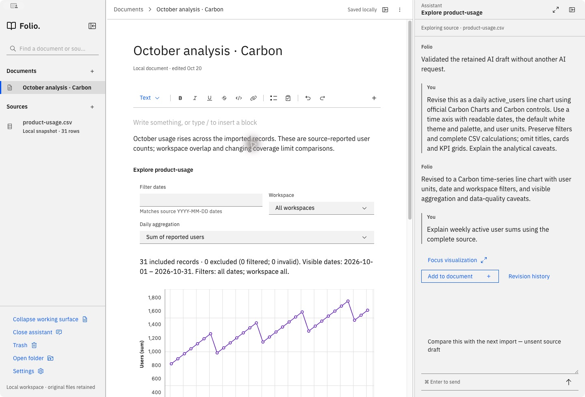

<div align="center">
  
  <h1>Folio</h1>
  <p><strong>Write. Explore data. Keep the reasoning.</strong></p>
  <p>A local document workspace with interactive CSV analysis and contextual AI.</p>
  <p>
    <a href="https://github.com/lukivan8/folio/actions/workflows/ci.yml"></a>
    <a href="LICENSE"></a>
    
    
  </p>
  <p><a href="#get-started">Get started</a> · <a href="#the-workflow">Workflow</a> · <a href="#continue-development">Development</a> · <a href="docs/ARCHITECTURE.md">Architecture</a> · <a href="CONTRIBUTING.md">Contributing</a></p>
</div>



_Actual application, using synthetic example data._

Folio keeps writing at the center. Paragraphs, headings, lists, checklists, and tables form a continuous editable document. An interactive visualization is another block in that document, with its data and methodology available for inspection.

Explore a CSV in its own conversation, bring a finding into a document, and revise the analysis without losing the last working result. Your files, original CSV bytes, calculations, parameters, and revision history stay together locally.

> **Development preview · v0.1.0.** The tested desktop target is macOS Apple Silicon. Builds are unsigned and unnotarized. Windows, Linux desktop, and Intel Mac support have not been validated. See [verification and release gaps](docs/VERIFICATION.md).

## What is here

| Capability           | How it works                                                                                                |
| -------------------- | ----------------------------------------------------------------------------------------------------------- |
| Documents first      | Tiptap editing, block insertion, formatting, tables, and Carbon checkboxes.                                 |
| Shared CSV sources   | Import a snapshot once, review parsing and types, and explore it before writing a report.                   |
| Contextual AI        | Separate source and visualization conversations in a resizable right pane.                                  |
| Inspectable analysis | Original inputs, methodology, result tables, analytical caveats, and candidate checks.                      |
| Safe revision flow   | A candidate is compiled and checked before promotion; failed or cancelled runs preserve the working result. |
| Portable work        | Local document folders contain the editor content and analysis bundles; no Folio backend is required.       |
| One UI foundation    | Official Carbon React components, IBM Plex, White theme tokens, and Carbon Charts.                          |

## Get started

### Requirements

- **macOS on Apple Silicon** for the complete, tested desktop workflow.
- **Git** and **Node.js 22** with npm. The exact tested version is in [.nvmrc](.nvmrc); use `nvm install && nvm use` if you use nvm.
- Internet access to install dependencies. AI additionally needs supported ChatGPT/Codex account access; local editing and starter analyses work without signing in.

### Clone and run

```sh
git clone https://github.com/lukivan8/folio.git
cd folio

# Optional, if you use nvm:
nvm install
nvm use

IBM_TELEMETRY_DISABLED=true npm ci
npm run dev
```

`npm run dev` builds the Electron main process and preload, starts Vite on `127.0.0.1:5173`, and opens the desktop app. The pinned Codex runtime comes from npm; a separate global Codex installation is unnecessary. No `.env`, API key, database, or hosted Folio service is required.

**Connect AI:** open Folio's **Settings** and use **Connect ChatGPT**. Complete the provider's browser sign-in. Account eligibility and usage limits apply; there is no automatic paid API fallback. AI requests can send prompts and source content read by the agent to the provider. Local storage does **not** mean offline AI inference.

**Try without AI:** import [fixtures/product-usage.csv](fixtures/product-usage.csv), accept parsing, and choose **Create local exploration**. Editing, local computations, filters, and saved artifacts remain available independently of AI.

### Component development and browser preview

```sh
npx playwright install chromium  # one-time browser download for UI tests
npm run storybook               # http://127.0.0.1:6006
```

Storybook contains the actual Carbon primitives, editor blocks, checklist states, modal focus behavior, and source-to-document flows. It is the preferred place to develop isolated interactions.

`npm run preview` starts a browser-only Vite preview. It has separate browser storage and lacks native folder access, trusted artifact compilation, and desktop account integration. Use Electron for the full workflow.

## The workflow

1. **Import a source.** Use **Sources → +**, select a CSV, inspect the preview and schema, and accept parsing. Sources are snapshots, not live connectors.
2. **Explore before writing.** Open the source and ask a question in the right pane, or create a local exploration.
3. **Keep a finding.** Choose **Add to document**. Folio inserts editable prose and a live visualization, preserving the source IDs, calculations, parameters, and methodology.
4. **Write naturally.** Every paragraph is a block. Use `/` or the gutter to insert content. Chart filters recompute locally without opening chat.
5. **Inspect or revise.** Focus the visualization for **Sources / Methodology / Result data**. Return to its conversation to request a change; Stop, retry, and revision history preserve working output.
6. **Come back later.** Documents save locally. Reopen the app or use a portable copy to continue elsewhere.

The left pane holds documents and shared sources; the center holds the selected document or source view; the right holds contextual chat or a focused visualization. Pane resizing, collapse state, and separate drafts support both compact and wide desktop layouts.

## Continue development

Create a branch and start with these references:

| Reference                                                  | Purpose                                                                                          |
| ---------------------------------------------------------- | ------------------------------------------------------------------------------------------------ |
| [CONTRIBUTING.md](CONTRIBUTING.md)                         | Change workflow, checks, fixtures, and pull requests.                                            |
| [AGENTS.md](AGENTS.md)                                     | Repository instructions for coding agents and contributors.                                      |
| [Design system](docs/DESIGN_SYSTEM.md)                     | **Canonical UI authority:** Carbon packages, theme, tokens, runtime integration, and exceptions. |
| [Architecture](docs/ARCHITECTURE.md)                       | Process boundaries, portable format, source library, persistence, and generation.                |
| [Components](docs/COMPONENTS.md)                           | Shared wrappers, Storybook, and interaction regressions.                                         |
| [Visualization authoring](skills/block-authoring/SKILL.md) | Rules for generated calculations, charts, inspection, and checks.                                |
| [Verification](docs/VERIFICATION.md)                       | Tested flows, known limits, and remaining release work.                                          |
| [Product specification](docs/SPECIFICATION.md)             | Historical requirements; current Carbon guidance supersedes historical styling choices.          |

```text
src/                    React workspace, Tiptap editor, inspectors, and runtime
  components/ui/        Thin shared wrappers around official Carbon controls
  editor/               Editor extensions, checklist node view, and stories
  styles/               Carbon theme, tokens, and isolated-runtime styles
  workspace/            Pane composition and interaction stories
electron/               Native integration, storage, compiler, and Codex adapter
skills/block-authoring/ Visualization-authoring instructions
fixtures/               Synthetic CSV and generated-code regression fixtures
tests/                  Deterministic parsing, storage, calculation, and protocol tests
scripts/                Build, development, licensing, and native smoke checks
docs/                   Design decisions, format, validation, and third-party notices
```

Renderer changes reload in development. Restart `npm run dev` after changing Electron, preload, or compiler code. For UI work, add or update the adjacent Storybook story and follow [Carbon's documented patterns](https://carbondesignsystem.com/).

### Work safely on another machine

A clone contains **source code and synthetic fixtures**, not your documents, source library, preferences, or provider credentials.

- For an individual document, choose **Save portable copy** on the original machine. Transfer the complete folder, then use **Open folder** in Folio on the new machine. Keep its internal files and identifiers together. The copy includes that document's inputs and revisions, not the shared library's entire exploration history.
- For the entire workspace, quit Folio first and back up both its document store and Electron user-data directory. **Open folder** reveals document storage; the default store is `documents` under Electron's application user-data directory. Preserve `_sources` when moving the shared library. Keep these private files outside the Git clone and sign into AI separately.
- Use the overrides below for a new, isolated development workspace. They are optional; the normal launcher continues using existing saved work.

```sh
mkdir -p work/qa-data work/qa-profile
FOLIO_DATA_DIR="$PWD/work/qa-data" \
FOLIO_PROFILE_DIR="$PWD/work/qa-profile" \
npm run dev
```

`FOLIO_DATA_DIR` selects the document/source store. `FOLIO_PROFILE_DIR` selects Electron's local preferences/profile. Neither configures provider authentication. Do not run two Folio instances against the same store.

### Checks

```sh
npm test                    # deterministic core tests; no account or inference
npm run check:ui             # Chromium interactions/accessibility + static Storybook
npm run build                # TypeScript + renderer + Electron bundles
```

On Linux, install browser system dependencies with `npx playwright install --with-deps chromium`. The GitHub Actions workflow runs these checks without provider credentials. Native packaging and AI checks are separate:

```sh
npm run test:ai                  # account/protocol smoke test; no inference
npm run test:ai -- --generate    # real provider request using synthetic data
npm run test:isolation           # macOS permission-boundary canaries
npm run package                  # unsigned macOS arm64 application folder
npm run test:package             # packaged compiler: starter + Carbon + legacy fixtures
```

Provider checks require supported access and may consume your account's usage. Never use real user data for automated AI verification. See [VERIFICATION.md](docs/VERIFICATION.md) for the recorded native checks and limits.

### Build a desktop app

On the supported Mac:

```sh
npm run package
open release/mac-arm64/Folio.app
```

You can also use `Launch Folio.command` after packaging. Generated binaries are excluded from Git. Packaging currently produces an app directory, not a signed installer; signing, notarization, and clean-machine distribution checks remain release work.

### Troubleshooting

| Symptom                                                | Next step                                                                                                 |
| ------------------------------------------------------ | --------------------------------------------------------------------------------------------------------- |
| Chromium executable missing in UI tests                | Run `npx playwright install chromium`.                                                                    |
| Port 5173 or 6006 already in use                       | Stop the previous Folio/Vite or Storybook process before restarting.                                      |
| Electron changes do not appear                         | Restart `npm run dev`; main/preload/compiler files are built at startup.                                  |
| ChatGPT unavailable or a request fails                 | Check Settings, account eligibility, and provider limits. Keep the working revision and retry explicitly. |
| Folder or generation features unavailable in a browser | Launch the Electron app; the browser preview is intentionally limited.                                    |
| Upstream Carbon Sass deprecation notices               | The pinned build currently passes with these notices; do not edit vendor packages.                        |

## Privacy and security

There is no Folio-hosted backend. The app stores documents locally, while AI generation uses the provider through the pinned Codex app-server. Generated views run in isolated frames with restricted messaging and no host bridge; calculations run in workers. These boundaries and their limits are described in [architecture](docs/ARCHITECTURE.md) and [security reporting](SECURITY.md).

Do not commit document stores, original private CSVs, conversations, credentials, or local profiles. The checked-in fixtures and screenshot use synthetic data. Existing saved visualizations retain legacy Recharts compatibility; new authoring defaults to Carbon Charts.

## Contributing and license

Bug reports and focused pull requests are welcome. Start with [CONTRIBUTING.md](CONTRIBUTING.md), use synthetic reproductions, and check the [known release gaps](docs/VERIFICATION.md) before taking on work.

Folio's application-owned source and documentation are licensed under the **[MIT License](LICENSE)**. Dependencies, bundled fonts, and reused assets retain their own licenses; see the [dependency inventory](docs/DEPENDENCIES.md) and [preserved notices](docs/third-party-licenses). Carbon, IBM Plex, Electron, React, Tiptap, and Codex are independent projects; this repository does not imply their endorsement.
